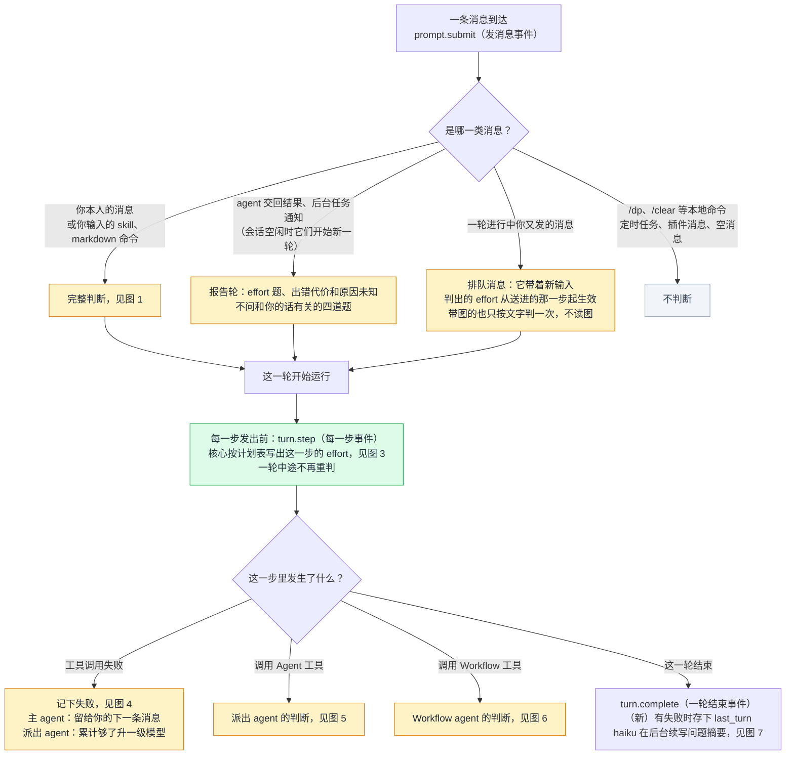
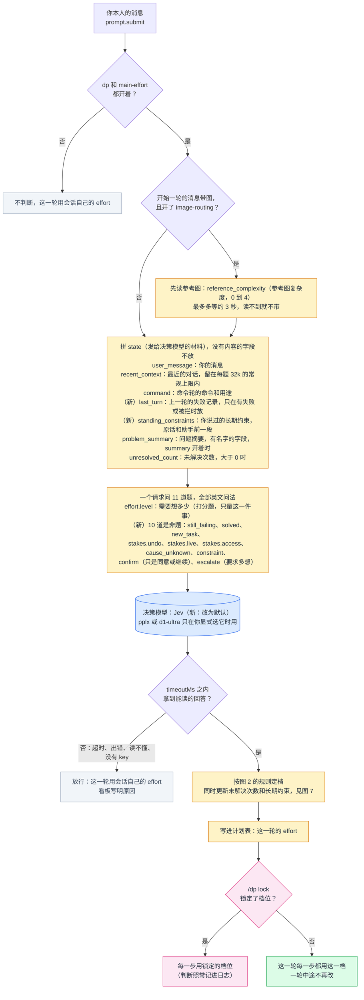
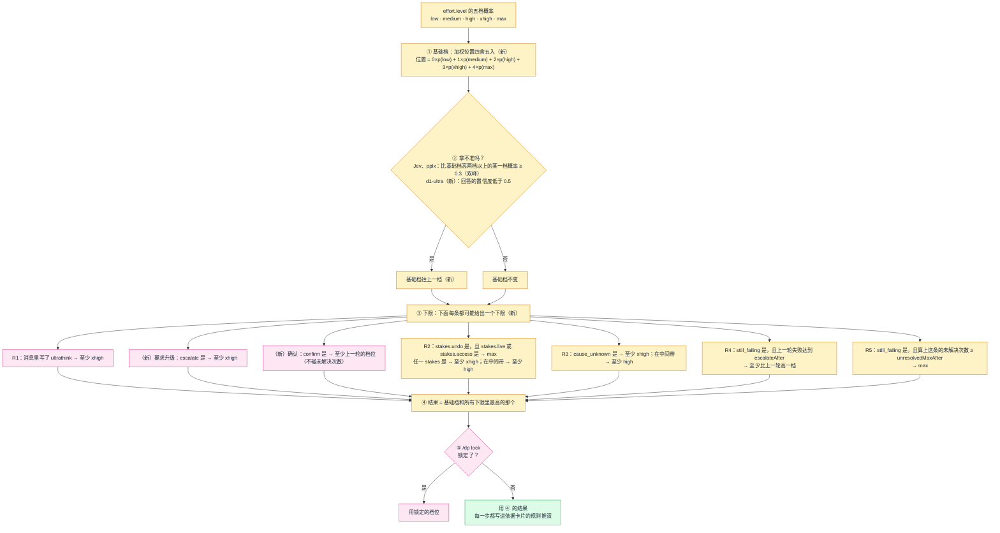
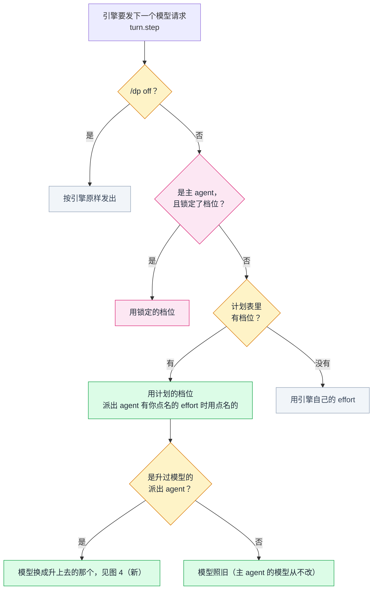
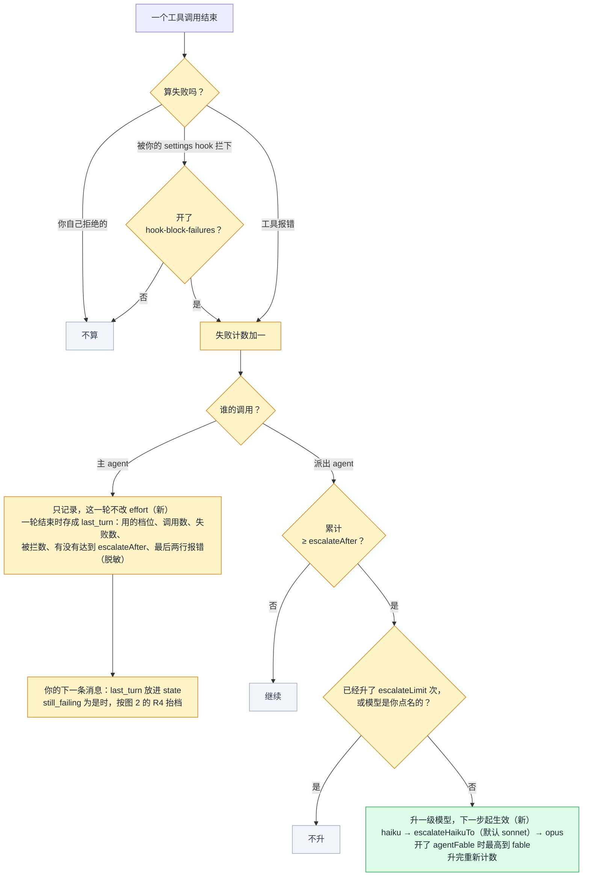
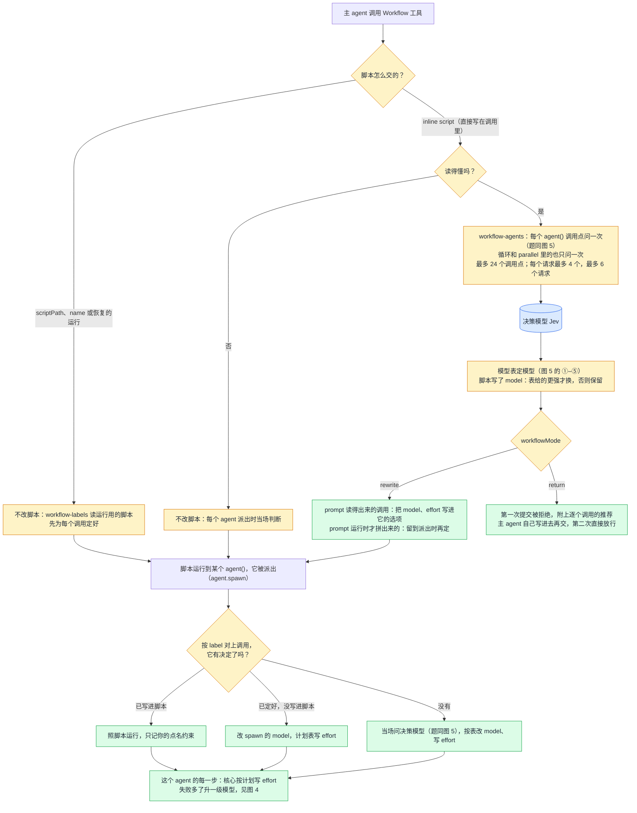
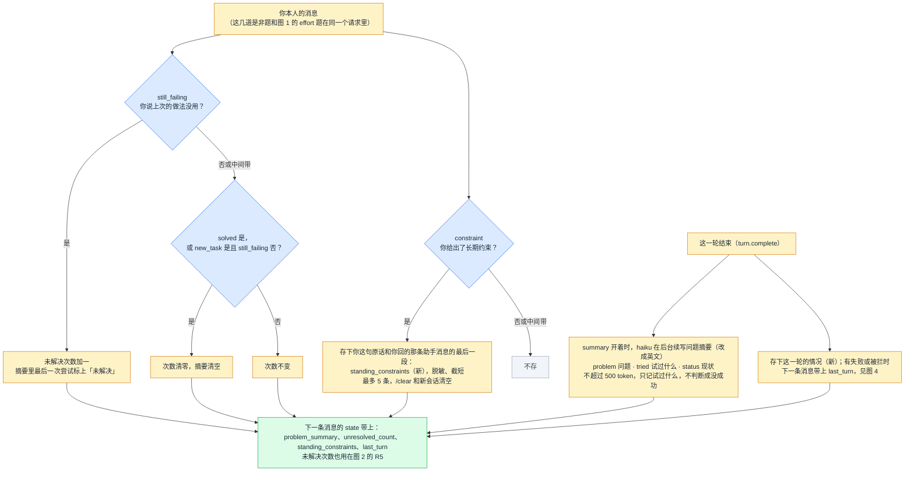
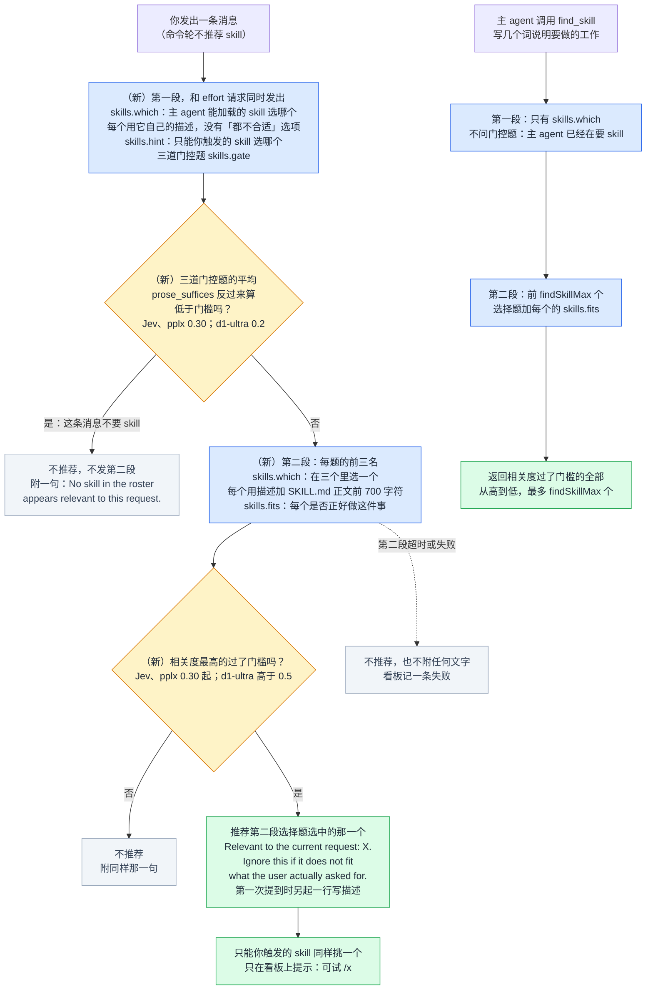

# Dispatch Pilot 的 effort 和 agent 决策流程（改动后，0.9.0）

本文画的是 dispatch-pilot 0.9.0 的流程：适配 Claude Code 2.1.312（ADR 0013），按 TypeSafe 官方指南重写发消息时的判断（ADR 0014）和派出 agent 选模型的办法（ADR 0015），加上「确认」「要求升级」两道题（ADR 0016），以及可选的 Liquid d1-ultra，它的回答按 Liquid 官方的读法读（ADR 0017），最后照 TypeSafe 的 skill 推荐 cookbook 重写 skill 推荐（ADR 0018）。改动前的流程见 [dispatch-pilot-decision-flow.md](dispatch-pilot-decision-flow.md)，两份的图号一一对应，可以对照着看。

进度：

- 第 1 阶段（删除中途重判、改造失败处理）已实现（ADR 0013）。
- 第 2 阶段（Jev 默认、新的判断题和代码规则、问题摘要和长期约束）已实现（ADR 0014），本文按实现改过；有出入时以代码为准。
- 第 2b 阶段（派出 agent 和 Workflow 里的 agent 改成是非题加代码里的模型表，删掉 `agentOverride`）已实现（ADR 0015），图 5、图 6 按实现画。
- 第 2c 阶段（发消息时加 `confirm`、`escalate` 两道是非题；文字决策可选 d1-ultra，按 Liquid 的线和路由，图片仍用 Jev）已实现（ADR 0016、0017），图 1、图 2、图 5 按实现画。
- 第 4 阶段（skill 推荐和 `find_skill` 照 TypeSafe 的 skill 推荐 cookbook 重写，门槛按各家的官方指南，删掉 skill 画像）已实现（ADR 0018），见图 8。

图里的颜色和改动前那份相同：

- 蓝色：问决策模型（默认 Jev）
- 黄色：代码里的规则
- 绿色：最后用的 effort 或模型
- 粉色：你自己的控制（锁定、点名）
- 灰色：不判断，或判断失败、放行
- 标「（新）」的：这次新加的

几个贯穿全文的约定：

- **是非题怎么读**：按决策模型的官方读法（`decision/guides.ts`）。Jev 和 pplx：概率 ≥ 0.7 算「是」，≤ 0.3 算「否」（TypeSafe 官方给的起点）；d1-ultra：大于 0.8 算「是」，小于 0.2 算「否」（Liquid 指南的示例）。中间算「中间带」，各有自己的去向。
- **一轮里 effort 不再变**：Claude Code 2.1.312 起，一轮中途改 effort 要等到下一条有新输入的消息才生效。所以主 agent 的 effort 只在消息到达时定一次；你在一轮进行中发的排队消息带着新输入，可以改它。排队消息带了图也只按文字判一次，不读图：读完图再判的那一次可能落在只带工具结果的一步上，那一步改 effort 不生效，看板却会写着它。
- **置信度**：Jev 和 pplx 的门槛都读概率，不读置信度。d1-ultra 按 Liquid 官方读法用置信度 0.5：effort 回答的置信度低于 0.5 再往上一档，派出 agent 的路由置信度低于 0.5 退到最强的模型。

目录：

- 图 0　总览
- 图 1　发消息时：主 agent 的 effort
- 图 2　定档规则：基础档加下限
- 图 3　一轮进行中：每一步怎么发出
- 图 4　工具调用失败
- 图 5　派出 agent 的模型和 effort
- 图 6　Workflow 里的 agent
- 图 7　未解决次数、长期约束和问题摘要
- 图 8　skill 推荐和 find_skill
- 删掉的参数

---

## 图 0　总览

| 英文 | 中文 | 是什么意思 |
|---|---|---|
| `prompt.submit` | 发消息事件 | 你发出一条消息、引擎收到它时触发。effort 只在这里定 |
| `turn.step` | 每一步事件 | 一轮里每个模型请求发出前触发。核心在这里写出这一步的 effort（派出 agent 还有模型） |
| `turn.complete` | 一轮结束事件 | 一轮结束时触发。失败记录和问题摘要在这之后写 |
| 报告轮 | | 派出 agent 交回结果、后台任务结束，会话空闲时开始的新一轮。只问 effort 题、三道出错代价和原因未知；问「你说了什么」的四道是非题（`still_failing`、`solved`、`new_task`、`constraint`）不问，未解决次数、长期约束和摘要也不放进 state |
| 排队消息 | | 你在一轮进行中发的消息，引擎在下一步把它送进这一轮。它是新输入，所以它判出的 effort 能生效。带图时只按文字判一次 |

---

## 图 1　发消息时：主 agent 的 effort

| 英文 | 中文 | 是什么意思 | 默认 |
|---|---|---|---|
| `decisionModel` | 决策模型 | 改为默认 Jev。pplx 只在你显式设成 `pplx` 时用，不再自动退回它；没有 TypeSafe key 时看板写明缺 key、不路由。（新）设成 `d1-ultra` 用 Liquid 的 d1-ultra，只管文字，图仍给 Jev；没有 Liquid key 时同样不路由 | `jev` |
| `timeoutMs` | 等待上限 | 等决策模型回答的最长时间，超过就放行。d1-ultra 满预算的请求要 2.0–2.7 秒，所以它的默认是 4000 | 1500 毫秒（d1-ultra 4000） |
| `contextTokens` | state 预算 | 不再带长上下文请求头，state 留在 Jev 每题 32k 的常规上限内：24000 加最长的一题约 2.72 万（Jev 计），在 32k 的 90% 以内（算法见 DEVELOPMENT.md「Jev 的上下文默认值怎么算」）；带 skill 推荐题的请求仍是 6000 | 24000 |
| `user_message` | 你的消息 | 原文，secret 已脱敏 | |
| `recent_context` | 最近对话 | 只有文字和工具名（比如 `Bash x3 (1 failed)`），不含文件内容和工具输出 | |
| `command` | 命令 | 命令轮里你输入的命令和参数，以及这个命令是做什么的 | |
| `last_turn` | 上一轮失败记录（新） | 代码记下的事实：上一轮的档位、调用数、失败数、被拦数、有没有达到 `escalateAfter`、最后两行报错。没有失败也没有被拦就不放 | |
| `standing_constraints` | 长期约束（新） | 你说过的「这是真钱」「不能回滚」「别动 X」这类话，原样保存，连同你回的那条助手消息的最后一段，最多 5 条 | |
| `problem_summary` | 问题摘要 | haiku 用英文写的，改用有名字的字段：`problem` 问题、`tried` 试过什么（每条带 `unresolved`）、`status` 现状。`summary` 开关关着时不放 | |
| `unresolved_count` | 未解决次数 | 你说「还是不行」的次数，由代码数；这条消息之前的次数，大于 0 才放 | |
| `effort.level` | 推理需求（打分题） | 只量「这项工作需要想多少」。「这项工作」指助手为这条消息做的全部事情，直到下次停下来等你 | |
| 英文问法 | | 按官方，英语是 Jev 准确率最好的语言；你的消息和对话仍原样送 | |

10 道是非题见图 2 和图 7 的表。

---

## 图 2　定档规则：基础档加下限

下限只往上抬，从不往下压；锁定优先于一切。「是」「中间带」按决策模型的线：Jev、pplx 0.7 / 0.3，d1-ultra 0.8 / 0.2。

| 英文 | 中文 | 是什么意思 |
|---|---|---|
| 加权位置（`score`） | | 打分题的「平均落点」，0 到 4 之间。四舍五入到最近一档就是基础档（官方 cookbook 的做法） |
| 双峰 | | 概率同时堆在低处和高处，平均落点会被拉到中间、看不出来。官方提醒要看各档概率；比基础档高两档以上的某档概率 ≥ 0.3，就往上一档。Jev 和 pplx 用它 |
| 置信度低（新） | | d1-ultra 用它代替双峰：打分题回答的置信度低于 0.5 就往上一档（借 Liquid 路由示例的 0.5，Liquid 没写打分题怎么办） |
| `escalate` | 要求升级（是非题，新） | 你是否要求多想、做得更仔细，或用更强的模型（「仔细一点」「认真想想再改」），没写 ultrathink 也算。为是至少 xhigh |
| `confirm` | 确认（是非题，新） | 你是否只是同意、让继续或从助手给出的选项里选一个（「好，就这么做」「继续」「选 2」）。为是这一轮至少等于上一轮的档位：要做的就是上一轮定下的事 |
| `ultrathink` | 深度思考关键词 | 你在消息里写了它（不在引号里、不在路径里），引擎会把这一轮抬到 xhigh；dp 不再把它压下去。0.9.2 起，环境变量 `CLAUDE_CODE_DISABLE_ULTRATHINK`（2.1.316）关掉这个关键词时引擎不抬，R1 也不抬 |
| `stakes.undo` | 难以挽回（是非题） | 这项工作出错是否难以撤回，比如删数据、消息已发出、已发布的版本 |
| `stakes.live` | 线上或真钱（是非题） | 这项工作是否作用在线上系统或真钱上 |
| `stakes.access` | 权限（是非题） | 这项工作是否改权限、认证或密钥 |
| `cause_unknown` | 原因未知（是非题） | 这项工作是否包括找出对话里还没找到的故障原因 |
| `still_failing` | 仍未解决（是非题） | 你是否在说上次试过的做法没用、问题还在。只看你自己的话 |
| `escalateAfter` | 失败次数门槛 | 上一轮主 agent 的失败达到它，你又说还没解决，这一轮至少比上一轮高一档。默认 2 |
| `unresolvedMaxAfter` | 直接用 max 的次数 | 算上这条，你说「还是不行」的次数达到它，这一轮用 max（取代原来的强提示题）。默认 3 |

---

## 图 3　一轮进行中：每一步怎么发出

原来的「中途重判」整块删除：每隔几步重判、派出 agent 或加载 skill 时重判、读到参考图时重判，以及它的升降档防抖，都没有了。

---

## 图 4　工具调用失败

| 英文 | 中文 | 是什么意思 | 默认 |
|---|---|---|---|
| `escalation` | 失败处理开关 | 关掉后不给派出 agent 升模型；主 agent 的失败照样记，`last_turn` 不受它影响（只有 `/dp off` 停止计数） | 开 |
| `escalateAfter` | 失败次数门槛 | 派出 agent：失败累计满几次升一级模型；主 agent：上一轮失败满几次，下一条消息才可能触发 R4 | 2 |
| `escalateLimit` | 升级次数上限 | 一个派出 agent 最多升几次模型 | 2 |
| `escalateHaikuTo` | haiku 升成的模型 | haiku agent 第一次升级换成哪个模型 | `sonnet` |
| `agentFable` | 允许 fable | 打开后，升级阶梯的最高一级是 fable | 关 |
| `hook-block-failures` | hook 拦截算失败 | 打开后，你自己的 settings hook 拦下的调用也算失败 | 关 |
| 为什么升模型不升 effort | | 2.1.312 实测：一轮中途换模型立即生效，改 effort 不生效 | |

---

## 图 5　派出 agent 的模型和 effort

选 Jev 或 pplx 时，决策模型只回答关于任务的是非题，模型由代码按一张表定（ADR 0015，TypeSafe 的「判断交给模型，决定写在代码里」）。（新）选 d1-ultra 时改按 Liquid 官方的路由示例：一道选择题选档位，置信度低于 0.5 退到最强的模型（ADR 0017）。

```mermaid
%%{init: {"flowchart": {"wrappingWidth": 360}}}%%
flowchart TD
    A["主 agent 调用 Agent 工具<br/>agent.spawn（派出事件）"] --> SK{"fork、teammate、<br/>被唤醒的，或开关关着？"}
    SK -->|是| PASS["原样放行"]
    SK -->|否| REQ["问 Jev（同一条消息里一起派出的合进一个请求，每个请求最多 4 个 agent）<br/>关于任务的是非题（新）：writes · few_steps · report_only<br/>stakes.undo · stakes.live · stakes.access · cause_unknown<br/>design_open · outside_facts · science_code · frontier（开了 agentFable 才问）<br/>每步用哪档 effort（打分题）；你点名或排除了哪个模型、哪档 effort<br/>state：任务、描述、agent 类型、你这一轮的话、派出它的对话"]
    REQ --> DM[("决策模型 Jev")]
    DM --> OK{"等待上限之内<br/>拿到回答？"}
    OK -->|否| PASS2["按主 agent 原来的要求启动<br/>用引擎的 effort，看板写「未路由」"]
    OK -->|是| R1{"① 你点名了模型（≥ 0.7）？"}
    R1 -->|是| M1["用你点名的"]
    R1 -->|否| D1{"（新）决策模型是 d1-ultra？"}
    D1 -->|是| RT["路由（Liquid 官方示例）：route 选择题<br/>fast → haiku · standard → sonnet · powerful → opus<br/>开了 agentFable 加 frontier → fable<br/>取概率最高的一档；置信度低于 0.5 → 可用模型里最强的<br/>选中的被你排除 → 可用的里概率最高的一档"]
    RT --> PICK
    D1 -->|否| R2{"② 开了 agentFable，<br/>frontier 是？"}
    R2 -->|是| FA["fable"]
    R2 -->|否| R3{"③ 出错代价三题、原因未知、方案未定、<br/>仓库外事实、科学计算，任一为是？"}
    R3 -->|是| OP["opus"]
    R3 -->|否| R3B{"③b 这七题任一拿不准？"}
    R3B -->|是| SB["sonnet，effort 下限 max"]
    R3B -->|否| R4{"④ writes 否、few_steps 是、<br/>report_only 是？"}
    R4 -->|是| HA["haiku"]
    R4 -->|否| SO["⑤ sonnet"]
    FA --> BAN{"表给的模型被你排除了？"}
    OP --> BAN
    SB --> BAN
    HA --> BAN
    SO --> BAN
    BAN -->|是| NEAR["换成最近的可用模型：<br/>先往强的找，没有再往弱的找"]
    BAN -->|否| PICK{"主 agent 指定了模型，<br/>而且你没排除它？"}
    NEAR --> PICK
    PICK -->|否| MT["用表或路由给的"]
    PICK -->|"是，表或路由给的更强"| UP["升级到表或路由给的"]
    PICK -->|"是，表或路由给的不比它强"| KEEP["保留主 agent 的（只升不降）"]
    M1 --> EF{"你点名了 effort（≥ 0.7）？"}
    MT --> EF
    UP --> EF
    KEEP --> EF
    EF -->|是| E1["用你点名的，任何下限都不动它"]
    EF -->|否| E2["基础档：按图 2 的 ①② 定<br/>再按下限抬（只抬不压，取最高）：<br/>出错代价：难以挽回为是且线上或权限为是 max，任一为是 xhigh，任一拿不准 high<br/>原因未知：是 xhigh，拿不准 high<br/>表停在 ③b：max（d1-ultra 没有 ③b）<br/>模型下限：sonnet、opus 至少 medium"]
    E1 --> SP["改 spawn 的 model，启动 agent<br/>计划表记下它的 effort 和你的点名"]
    E2 --> SP
    SP --> STEPS["这个 agent 的每一步：核心按计划写 effort，见图 3<br/>失败多了升一级模型，见图 4"]
    SP --> NOTE["Agent 工具结果后面附一段说明：模型和 effort、表的哪一行、<br/>主 agent 的指定是保留还是升级、哪个下限抬了 effort"]

    classDef dm fill:#dbeafe,stroke:#2563eb,color:#1f2937
    classDef rule fill:#fef3c7,stroke:#d97706,color:#1f2937
    classDef out fill:#dcfce7,stroke:#16a34a,color:#1f2937
    classDef skip fill:#f1f5f9,stroke:#94a3b8,color:#334155
    classDef you fill:#fce7f3,stroke:#db2777,color:#1f2937
    class DM,REQ dm
    class D1,RT,R2,R3,R3B,R4,BAN,NEAR,PICK,EF,NOTE rule
    class SP,STEPS,FA,OP,SB,HA,SO,MT,UP,KEEP,E2 out
    class R1,M1,E1 you
    class PASS,PASS2 skip
```

| 英文 | 中文 | 是什么意思 | 默认 |
|---|---|---|---|
| `writes` | 改东西（是非题，新） | 任务是否要新建、修改、删除文件，或执行会改变什么的命令 | |
| `few_steps` | 一两步（是非题，新） | 一两次工具调用能否做完 | |
| `report_only` | 只汇报（是非题，新） | 结果是否只是按要求收集、排版（列表、表格、计数），没有要判断的 | |
| `stakes.undo` `stakes.live` `stakes.access` | 出错代价（是非题） | 和图 1 的三道一样，只是读的是派给 agent 的任务（`brief.prompt`） | |
| `cause_unknown` | 原因未知（是非题） | 任务里是否有没写明原因的故障要追查 | |
| `design_open` | 方案未定（是非题，新） | 任务是否要 agent 自己选一个没给出的做法 | |
| `outside_facts` | 仓库外事实（是非题，新） | 结论是否靠仓库和文档里查不到的外部事实（API 的行为、标准、版本差异） | |
| `science_code` | 科学计算（是非题，新） | 是否涉及数值、算法或科学计算代码 | |
| `frontier` | 前沿难题（是非题，新） | 是否要严格证明，或没有现成答案的新算法、新架构；只在开了 `agentFable` 时问 | |
| 模型表 | | ①–⑤ 从上往下，第一条成立的定模型；中间带的只走 ③b。缺的回答当「否」，但缺了就到不了 ④（不会因为没回答而用 haiku） | |
| 只升不降 | | 主 agent 指定了模型时，表给的更强才换成表给的，否则保留它的指定。你排除了它的指定，它就不算数 | |
| 点名（terms） | | 你在消息里说「用 opus」「effort 开 low」「别用 opus」，≥ 0.7 才算。点名的照办，排除的不用 | |
| `agentFable` | 允许 fable | 打开才问 `frontier`，表里才有 fable | 关 |
| 模型下限 | | sonnet、opus 至少 medium；haiku、fable 没有下限 | |
| `contextTokens` | state 预算 | 留在常规上限内。一个 agent 11 到 19 道题，一个请求最多 64 道，所以一个请求最多 4 个 agent | 24000 |
| `route` | 路由（选择题，新） | 只在 d1-ultra 上问，代替模型表那几道是非题：「这件事该交给哪一档模型」。`fast` 收集、查找、按要求列出；`standard` 方法已知的常规软件工作；`powerful` 出错代价高、原因未知、要选做法、靠仓库外事实、数值或科学计算；`frontier` 严格证明或没有现成答案的新算法、新架构（开了 `agentFable` 才有） | |
| 退到最强 | | d1-ultra 的路由置信度低于 0.5 时，用可用模型里最强的：opus，开了 `agentFable` 是 fable；最强的被你排除就取次强的 | |
| d1-ultra 的 effort | | 仍问出错代价三题和原因未知，只用来抬 effort；线是 0.8 / 0.2；没有 ③b 的 max；拿不准按置信度 | |

---

## 图 6　Workflow 里的 agent

每个 `agent()` 调用点和派出的 agent 走同一条路：同样的题、同一张模型表、同样的 effort 下限（图 5）。脚本里写的 `model` 当作主 agent 的指定，只升不降。

参数：`workflow-agents`、`workflow-labels` 两个开关默认开，`workflowMode` 默认 `rewrite`。

---

## 图 7　未解决次数、长期约束和问题摘要

| 英文 | 中文 | 是什么意思 | 默认 |
|---|---|---|---|
| `still_failing` | 仍未解决（是非题） | 你是否在说上次试过的做法没用、问题还在。只看你自己的话，助手说的「已修复」不算 | |
| `solved` | 已解决（是非题） | 你是否在说问题解决了，或接受了结果（「好了」「可以提交了」） | |
| `new_task` | 新任务（是非题） | 你是否转到另一个问题或任务。三道题拆开问，是因为一条消息可以同时说「还没好」和「另外做件事」 | |
| `constraint` | 长期约束（是非题） | 你这条消息是否给之后的工作定了规矩，比如某处不能碰、不能回滚、涉及真钱 | |
| `summary` | 问题摘要开关 | 和未解决次数分开：次数一直记（不花钱），摘要单独一个开关，默认开；0.8.x 的 `unresolved` 开关去掉了，存下的设置不再起作用 | 开 |
| `summaryModel` | 写摘要的模型 | 用你的 Claude Code 登录和用量调用；判断从不等它写完 | `haiku` |
| `unresolvedMaxAfter` | 直接用 max 的次数 | 见图 2 的 R5 | 3 |

---

## 图 8　skill 推荐和 find_skill

照 TypeSafe 的 skill 推荐 cookbook（ADR 0018）：先判断这条消息要不要 skill，再细看最相关的三个，最多推荐一个。问题是 cookbook 的原话；两道门槛按各家的官方指南，写在 `decision/guides.ts`，不是选项。主 agent 的 skill 列表照旧被拿走（派出 agent 的不动），`find_skill` 照旧只为主 agent 工作。

| 英文 | 中文 | 是什么意思 |
|---|---|---|
| `skills.which` | 选哪个 skill | 第一段：主 agent 能加载的 skill 里，哪个最适合用户最新的请求（cookbook 原话）。第二段：在前三名里只选一个 |
| `skills.hint` | 选哪个（你触发的） | 同样的问题，问只能你自己输入 `/名字` 触发的 skill；两类分开问，免得互相抢概率 |
| `skills.gate` | 门控题 | 三道是非题，换三种说法问这条消息是要动手做事还是只要解释：`acts_on_user_system`（要不要操作你的文件、账户、设备或在线服务）、`would_follow_documented_procedure`（专家会不会照现成的流程或命令做）、`prose_suffices`（懂行的人能不能光用文字答完，反过来算） |
| `skills.fits` | 是否正好做这件事 | 第二段对每个候选单独问一次，回答的概率就是相关度；选择题决定推荐哪个，相关度决定说不说 |
| 门槛 | | Jev 和 pplx 用 cookbook 的 0.30（门控的平均低于它不推荐，相关度最高的到它才推荐）；d1-ultra 用 Liquid 的（平均低于 0.2 不推荐，相关度高于 0.5 才推荐，来自它的二元判断和重排示例） |
| `findSkillMax` | find_skill 最多返回几个 | 也是 `find_skill` 第二段细看几个 |

---

## 删掉的参数

| 参数 | 中文 | 原来做什么 | 为什么删 |
|---|---|---|---|
| `thetaMax` | max 门槛 | max 自己的概率够高才用 max | 按我们自己 eval 调出的门槛，按官方改成读加权位置 |
| `roundUp` | 上取一档门槛 | 高一档概率够高就往上取 | 同上 |
| `hintThetaMax` | 强提示时的 max 门槛 | 强提示题的 max 门槛 | 强提示题删掉，改成代码下限 R5 |
| `rejudgeEvery` `rejudgeSteps` `rejudgeWaitMs` | 重判间隔、读几步、等待 | 中途重判 | 2.1.312 起一轮中途改 effort 不生效 |
| `thetaUp` `thetaDown` `holdSteps` | 升档、降档门槛，升档后保持 | 中途重判的防抖 | 同上 |
| `midturn-effort` | 中途重判开关 | | 同上 |
| `thetaExpected` | 预期内门槛 | 失败是否在意料之中 | 中途不再问决策模型 |
| `escalateMode` | 升档方式 | 升一档还是直接到 max | 不再中途升 effort |
| 三选一题和 0.5 / 0.7 门槛 | | 未解决次数加一、清零 | 拆成三道是非题，门槛用官方起点 0.7 / 0.3 |
| Jev 的中文问法 | | effort 题和派出 agent 题用中文问 | 官方：英语是 Jev 准确率最好的语言 |
| Jev 的长上下文请求头 | | state 最多 96000 | 官方：长上下文更慢、更不准；更早的几轮改由摘要和长期约束带进来（只有合并后超出常规上限的 agent 请求还会带） |
| `unresolved` 开关 | 未解决开关 | 次数、摘要、强提示一起开关，默认关 | 次数一直数（R5 要读）；摘要有自己的 `summary` 开关，默认开 |
| 按密钥自动换决策模型 | | 默认的 pplx 没有 key、Jev 有 key 时改用 Jev | 只谈 Jev：Jev 默认，pplx 只在显式选它时用，缺 key 就不路由 |
| 排队带图消息的第二次判断 | | 图读完后带着读数再判一次 | 可能落在只带工具结果的一步，那一步改 effort 不生效，看板却会写着它 |
| 派出 agent 选模型的选择题 | | 一道选择题从 haiku、sonnet、opus（加 fable）里选「能做好的最便宜的」，主 agent 的指定作为强提示写进题里 | 官方：判断交给模型、决定写在代码里；拆成十道是非题加代码里的模型表（ADR 0015） |
| `agentOverride` | 推翻门槛 | 决策模型的选择置信度到 0.6 才推翻主 agent 指定的模型 | 官方：置信度不是门槛；主 agent 的指定改成只升不降（ADR 0015） |
| `skillsMax` `skillsShortlist` | 最多推荐几个、第二段细看几个 | 一条消息最多推荐 3 个，第二段补读 4 个 | cookbook：最多推荐一个，第二段细看三个（ADR 0018） |
| `skillsMinRelevance` `findSkillMinRelevance` | 推荐、返回的门槛 | 0.75 和 0.5，按我们自己的评测挑的 | 改成各家指南的门槛：Jev、pplx 0.30，d1-ultra 0.5（ADR 0018） |
| skill 画像，`skillsProfileModel` `skillsProfilesPerSession`，`skill-profiles` 开关 | | haiku 给每个 skill 写中英文画像，排序时代替描述 | cookbook：每个 skill 用它自己的描述（ADR 0018） |
| skill 选择题的「都不合适」选项 | | 让第一段能说没有合适的 | cookbook：不放这个选项，另问三道门控题 |
