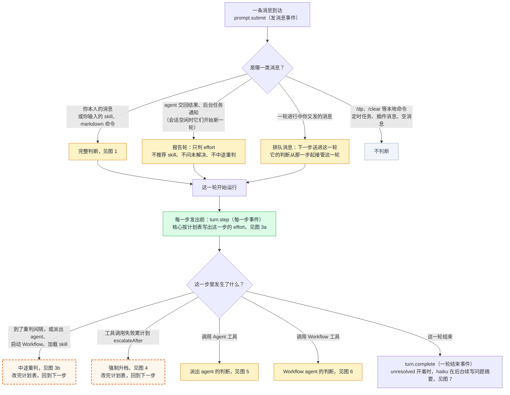
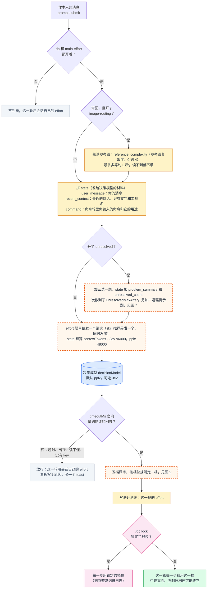
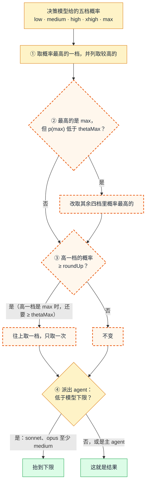
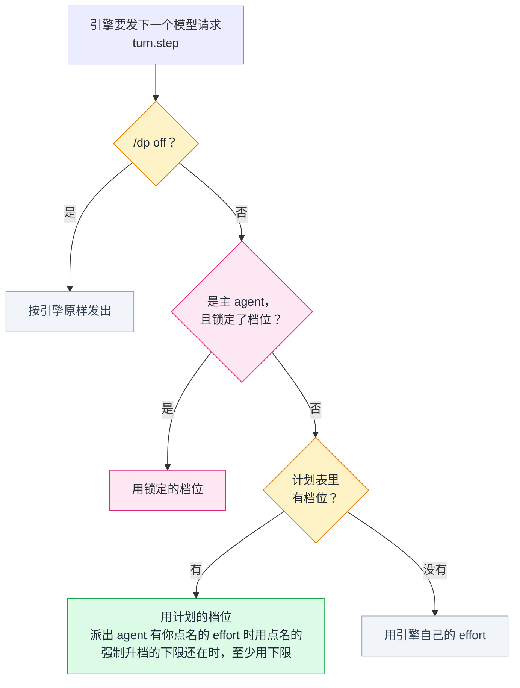
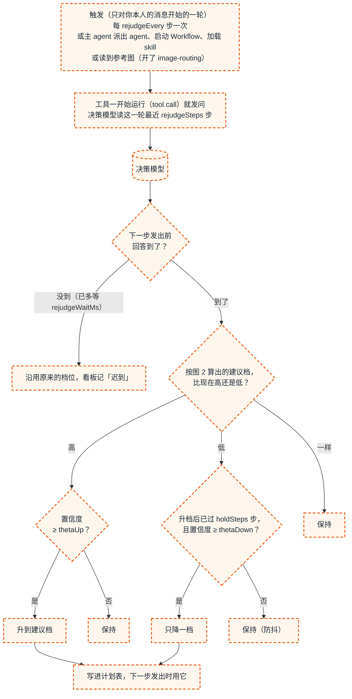
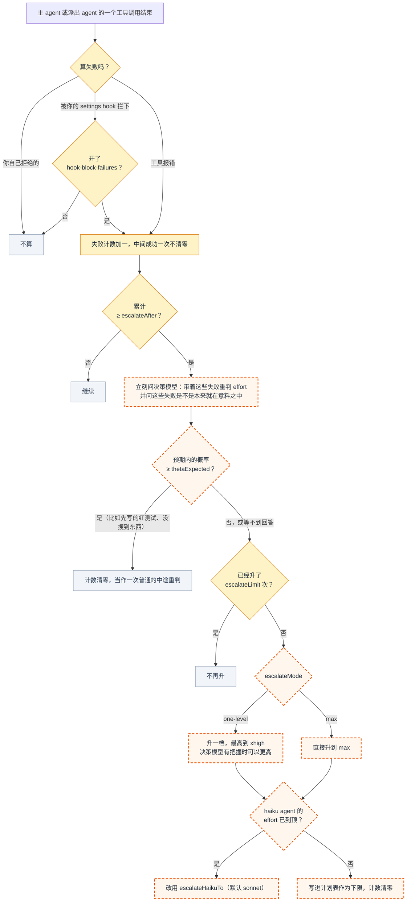
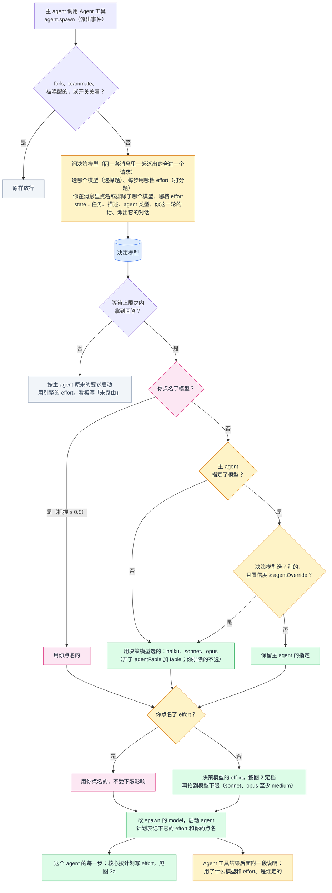
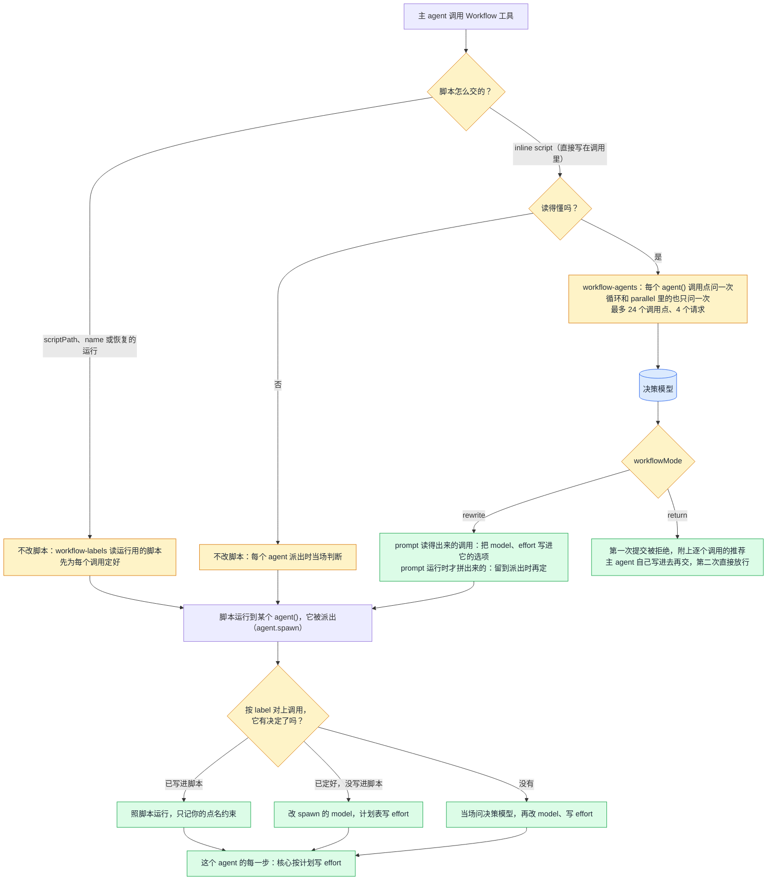
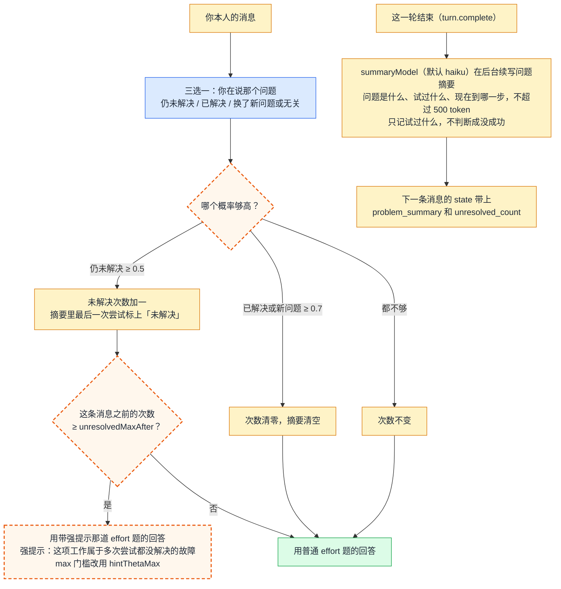

# Dispatch Pilot 的 effort 和 agent 决策流程

本文画的是 dispatch-pilot 0.8.2 的流程，也就是升级到 Claude Code 2.1.312、按 TypeSafe 官方指南改动之前的版本。改动后的流程见 [dispatch-pilot-decision-flow-0.9.0.md](dispatch-pilot-decision-flow-0.9.0.md)，图号一一对应。默认的决策模型是 pplx；两个模型默认值不同的参数，表里分列 Jev 和 pplx。

图里的颜色：

- 蓝色：问决策模型（pplx 或 Jev）
- 黄色：代码里的规则
- 绿色：最后用的 effort 或模型
- 粉色：你自己的控制（锁定、点名）
- 灰色：不判断，或判断失败、放行
- 橙色虚线框：`dp/official-guide` 分支上正在删除或改写的部分，见文末「改动预告」

目录：

- 图 0　总览：一条消息从进来到这一轮结束
- 图 1　发消息时：主 agent 的 effort
- 图 2　档位规则：五档概率怎么变成一档
- 图 3　一轮进行中：每一步怎么发出（3a），中途重判（3b）
- 图 4　卡住时强制升档
- 图 5　派出 agent 的模型和 effort
- 图 6　Workflow 里的 agent
- 图 7　未解决次数、强提示和问题摘要

---

## 图 0　总览

| 英文 | 中文 | 是什么意思 |
|---|---|---|
| `prompt.submit` | 发消息事件 | 你发出一条消息、引擎收到它时触发。发消息时的判断都从这里开始 |
| `turn.step` | 每一步事件 | 一轮里每个模型请求发出前触发。dp 的核心在这里写出这一步用的 effort（派出 agent 还有模型） |
| `turn.complete` | 一轮结束事件 | 一轮结束时触发。问题摘要在这之后写 |
| 报告轮 | | 派出 agent 交回结果、后台任务结束、另一个 Claude 会话发来消息，会话空闲时它们会开始主 agent 的新一轮。这种轮只判 effort |
| 排队消息 | | 你在一轮进行中又发的消息，引擎在下一步把它送进这一轮。它照常判断，判出的 effort 从那一步起接管这一轮 |

---

## 图 1　发消息时：主 agent 的 effort

| 英文 | 中文 | 是什么意思 | Jev | pplx |
|---|---|---|---|---|
| `main-effort` | 主 agent effort 开关 | 关掉后发消息时不判 effort | 开 | 开 |
| `image-routing` | 带图路由开关 | 你贴了参考图时，先读出「照着做有多复杂」，作为提示交给决策模型 | 关 | 关 |
| `reference_complexity` | 参考图复杂度 | 图像后端给的 0 到 4 的读数，只是提示，不直接定档 | | |
| `state` | 决策材料 | 和问题一起发给决策模型的数据 | | |
| `user_message` | 你的消息 | 你这条消息的原文，secret 已脱敏 | | |
| `recent_context` | 最近对话 | 这条消息之前的对话，只有文字和调用过的工具名（比如 `Bash x3 (1 failed)`），不含文件内容和工具输出 | | |
| `command` | 命令 | 命令轮里你输入的命令和参数，以及这个命令是做什么的；不读命令展开后的正文 | | |
| `unresolved` | 未解决次数开关 | 打开后多问一道三选一题，还会数次数、写摘要、给强提示，见图 7 | 关 | 关 |
| `contextTokens` | state 预算 | state 最多占多少 token，旧消息先丢。Jev 超过 24000 时带长上下文请求头 | 96000 | 48000 |
| `contextMessages` | 最近消息条数上限 | 最多带多少条最近的消息，实际发多少由 token 预算决定 | 2000 | 2000 |
| `decisionModel` | 决策模型 | 由谁来判断。默认 pplx；没有 Perplexity key 但有 TypeSafe key 时退回 Jev | | 默认 |
| `timeoutMs` | 等待上限 | 等决策模型回答的最长时间，超过就放行 | 1500 毫秒 | 8000 毫秒 |
| `/dp lock 档位` | 锁定 | 本会话里主 agent 每一步都用这一档，优先于所有判断 | | |
| `/dp off` | 总开关 | 关掉后不发任何决策请求，锁定也不生效，每一步按引擎原样发出 | | |

---

## 图 2　档位规则：五档概率怎么变成一档

| 英文 | 中文 | 是什么意思 | Jev | pplx |
|---|---|---|---|---|
| `low` `medium` `high` `xhigh` `max` | 五档 effort | 模型每次回答前思考的深度，从浅到深 | | |
| `p(max)` | max 的概率 | 决策模型认为该用 max 的概率 | | |
| `thetaMax` | max 门槛 | max 自己的概率至少要到这么高才用 max。发消息时、中途重判和派出 agent 都用它 | 0.5 | 0.47 |
| `roundUp` | 上取一档门槛 | 高一档的概率达到它，就往上取一档。理由是低估一档损失质量，高估一档只多花 token。内部值，不是选项 | 0.3 | 0.45 |
| 模型下限 | | 只对派出 agent：sonnet、opus 至少 medium；haiku、fable 没有下限 | | |

---

## 图 3　一轮进行中

### 3a　每一步怎么发出

### 3b　中途重判

整张图都在 `dp/official-guide` 分支上删除。

| 英文 | 中文 | 是什么意思 | Jev | pplx |
|---|---|---|---|---|
| `planStep` | 计划表写出 | 核心按顺序决定这一步的 effort（图 3a）。主 agent 的模型从不改 | | |
| `midturn-effort` | 中途重判开关 | 关掉后一轮进行中不再重新判断 | 开 | 开 |
| `tool.call` | 工具调用事件 | 工具开始运行时触发。重判在这时发问，趁工具运行的时间等回答 | | |
| `rejudgeEvery` | 重判间隔 | 一轮里每隔几步重判一次；0 表示不按步数，但派出 agent、启动 Workflow、加载 skill 时仍会重判 | 3 | 3 |
| `rejudgeSteps` | 重判读几步 | 决策模型读这一轮最近几步：主 agent 写的最后一段文字、调用的工具和每个调用怎么结束 | 16 | 16 |
| `rejudgeWaitMs` | 重判等待 | 下一步要发出时回答还没到，最多再等多久；等不到就沿用原来的档位 | 300 毫秒 | 6000 毫秒 |
| 置信度（confidence） | | 决策模型的回答有多集中，不等于「判对的概率」 | | |
| `thetaUp` | 升档门槛 | 升档要求的最低置信度 | 0.3 | 0 |
| `thetaDown` | 降档门槛 | 降档要求的最低置信度（不低于升档门槛），一次只降一档 | 0.55 | 0.55 |
| `holdSteps` | 升档后保持 | 升档之后多少步之内不降档（强制升档也算） | 5 | 5 |

---

## 图 4　卡住时强制升档

| 英文 | 中文 | 是什么意思 | Jev | pplx |
|---|---|---|---|---|
| `escalation` | 强制升档开关 | 关掉后失败再多也不升 | 开 | 开 |
| `escalateAfter` | 升档失败次数 | 失败累计满几次就问决策模型并升档 | 2 | 2 |
| `thetaExpected` | 预期内门槛 | 决策模型认为这些失败在意料之中的概率达到它，就不升档 | 0.25 | 0.25 |
| `escalateLimit` | 升档次数上限 | 一轮（或一个派出 agent）最多因为失败升几次；每次升档后计数清零 | 2 | 2 |
| `escalateMode` | 升档方式 | `one-level` 升一档，最高到 xhigh；`max` 直接升到 max | `one-level` | `one-level` |
| `escalateHaikuTo` | haiku 换成的模型 | 失败的 haiku agent 的 effort 已到顶时，接着用哪个模型；你点名或排除的模型优先 | `sonnet` | `sonnet` |
| `hook-block-failures` | hook 拦截算失败 | 打开后，你自己的 settings hook 拦下的调用也算失败 | 关 | 关 |

---

## 图 5　派出 agent 的模型和 effort

| 英文 | 中文 | 是什么意思 | Jev | pplx |
|---|---|---|---|---|
| `agent.spawn` | 派出事件 | 一个 agent 启动前触发，dp 在这里改它的模型 | | |
| `dispatched-agents` | 派出 agent 开关 | 关掉后派出的 agent 按主 agent 的要求启动 | 开 | 开 |
| fork、teammate | 分叉、队友 | 这两种 agent，以及被唤醒继续工作的 agent，dp 不改 | | |
| 点名（terms） | | 你在消息里说「用 opus」「effort 开 low」「别用 opus」。点名的照办，不受下限影响；排除的模型不用。判为点名要把握 ≥ 0.5；effort 的点名只在消息里出现 effort、档位名、推理这类字眼时才问 | | |
| `agentOverride` | 推翻门槛 | 主 agent 为它指定了模型时，决策模型选了别的、而且置信度达到它，才推翻主 agent 的指定 | 0.6 | 0.6 |
| `agentFable` | 允许 fable | 打开后决策模型也可以选 fable（比 opus 贵） | 关 | 关 |
| `contextTokens` | state 预算 | 派出 agent 的请求最多读多少 token | 96000 | 32000 |

---

## 图 6　Workflow 里的 agent

| 英文 | 中文 | 是什么意思 | 默认 |
|---|---|---|---|
| `workflow-agents` | 提交时判断的开关 | 主 agent 提交脚本时为每个 `agent()` 调用定模型和 effort | 开 |
| `workflow-labels` | 派出时设置的开关 | 脚本改不了或没来得及定的调用，在 agent 派出时按 label 设置 | 开 |
| `inline script` | 内联脚本 | 脚本直接写在 Workflow 调用里，dp 可以改写它 | |
| `scriptPath` / `name` | 脚本文件 / 存好的 Workflow | 这两种交法，以及恢复的运行，dp 改不了脚本 | |
| `label` | 标签 | 每个 `agent()` 的名字，派出时靠它找到对应的调用 | |
| `workflowMode` | Workflow 模式 | `rewrite`：把决定写进脚本再运行；`return`：退回给主 agent 自己写 | `rewrite` |

---

## 图 7　未解决次数、强提示和问题摘要

这一块要 `unresolved` 开关打开（默认关）。

| 英文 | 中文 | 是什么意思 | Jev | pplx |
|---|---|---|---|---|
| `still_unresolved` / `resolved` / `new_or_unrelated` | 仍未解决 / 已解决 / 新问题或无关 | 三选一题的三个选项。只看你自己的话；助手说的「已修复」不算 | | |
| 0.5 和 0.7 | 加一门槛、清零门槛 | 「仍未解决」概率 ≥ 0.5 就加一；「已解决」或「新问题」≥ 0.7 才清零。内部暂定值 | 0.5 / 0.7 | 0.5 / 0.7 |
| `unresolvedMaxAfter` | 强提示门槛 | 未解决次数达到它，就另问一道带强提示的 effort 题；0 表示不给 | 3 | 3 |
| `hintThetaMax` | 强提示时的 max 门槛 | 用带强提示的回答时，max 门槛改用它。内部值 | 0.4 | 0.47 |
| `problem_summary` | 问题摘要 | haiku 写的「问题、试过什么、现在到哪一步」，让决策模型看到超出预算的更早几轮 | | |
| `unresolved_count` | 未解决次数 | 你说「仍未解决」的次数；`/clear` 和新会话清零 | | |
| `summaryModel` | 写摘要的模型 | 用你的 Claude Code 登录和用量调用；判断从不等它写完 | `haiku` | `haiku` |

---

## 改动预告（`dp/official-guide` 分支）

图里橙色虚线框的部分正在改：

| 图 | 现在 | 改成 |
|---|---|---|
| 图 1 | 默认 pplx；Jev 用中文问法，state 最多 96000 并带长上下文请求头 | 默认 Jev，英文问法，state 留在每题 32k 的常规上限内；加几道窄的是非题和代码规则；问题摘要单独一个开关，默认开 |
| 图 2 | `thetaMax`、`roundUp` 这些按我们自己 eval 调出的门槛 | 删除。读打分题的加权位置并四舍五入；双峰时往上取一档；没有置信度门槛 |
| 图 3b | 中途重判 | 整块删除。Claude Code 2.1.312 起，一轮中途改 effort 要等到下一条有新输入的消息才生效 |
| 图 4 | 主 agent 和派出 agent 都升 effort | 主 agent：失败记录带到你的下一条消息，由那里的规则抬档；派出 agent：改成升模型（中途换模型立即生效） |
| 图 7 | 三选一，0.5 / 0.7 门槛，强提示另问一道题 | 拆成三道是非题，门槛用官方起点 0.7 / 0.3；强提示改成代码里的下限 |
