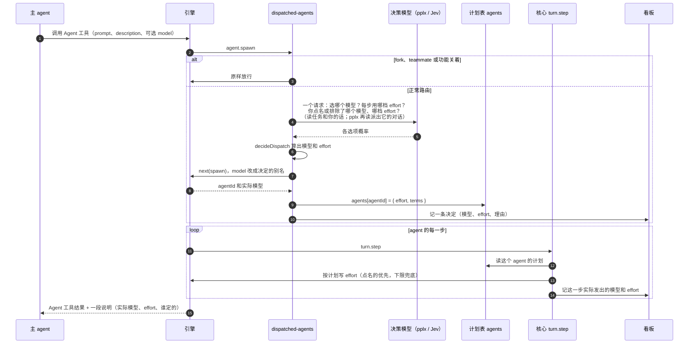
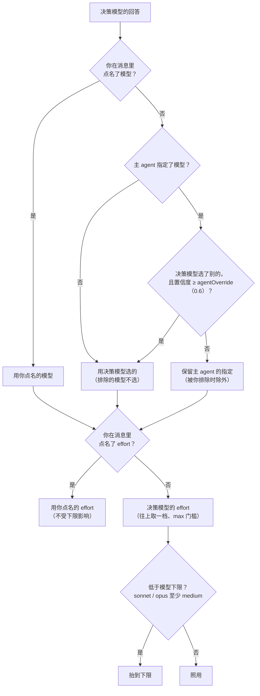
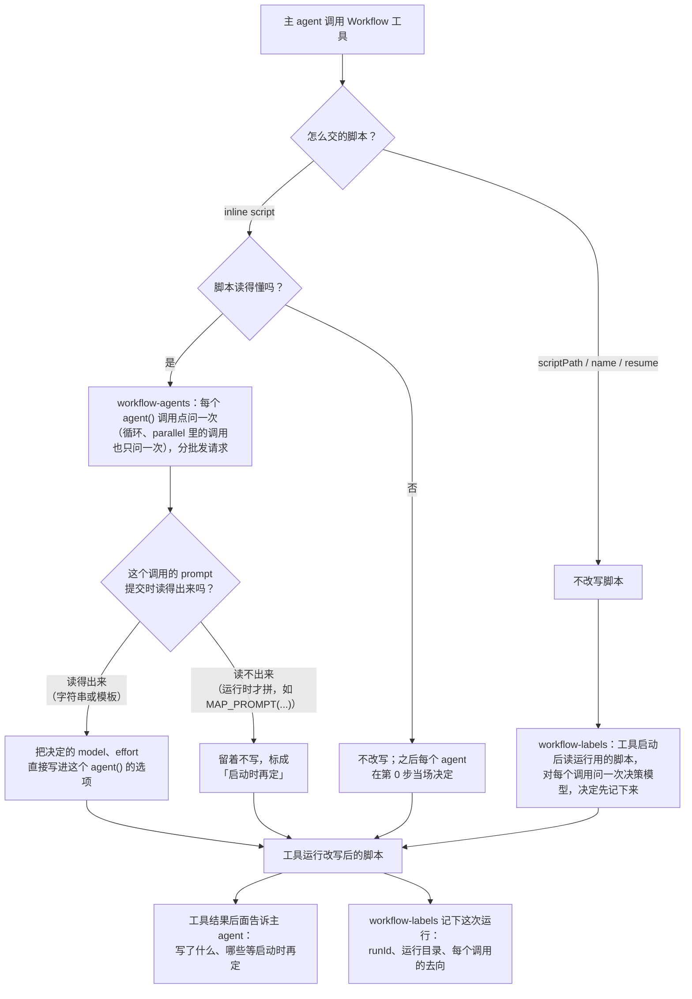
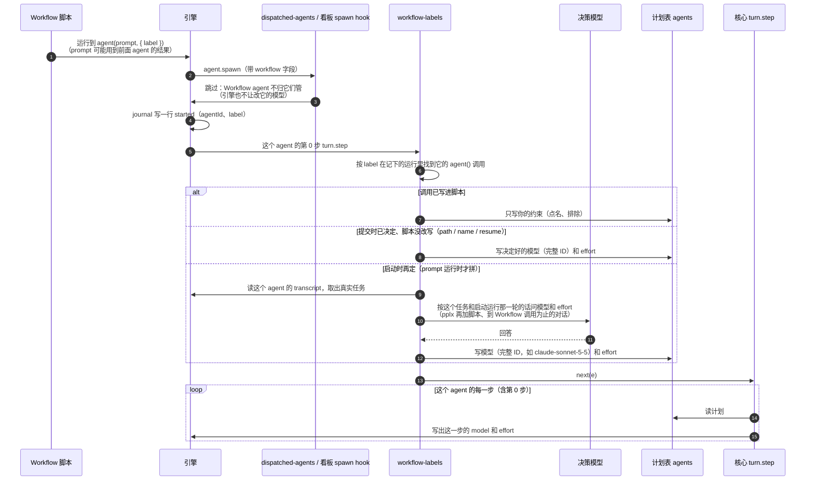
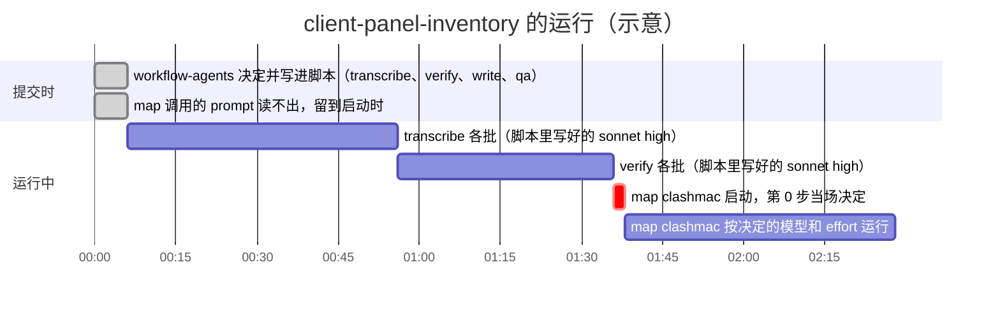
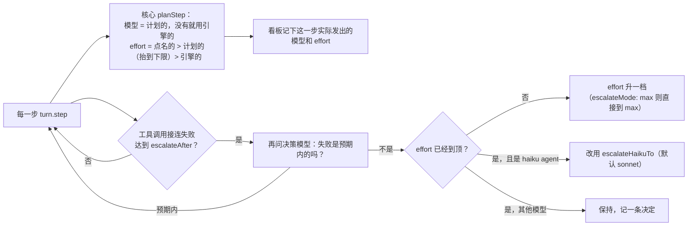

# Dispatch Pilot 的路由逻辑：普通子 agent 与 Workflow agent

本文对应 dispatch-pilot 0.4.1（Claude Code 2.1.296 实测）；决策模型读到什么、预算多大，见第四节（0.4.3 起，ADR 0007）。主 agent 自己的模型从不改变，这里只讲它派出去的 agent。

两类 agent 的根本区别：

| | 普通子 agent | Workflow agent |
|---|---|---|
| 谁启动它 | 主 agent 调用 Agent 工具 | Workflow 脚本里的 `agent()` |
| 什么时候决定 | 启动那一刻（`agent.spawn`）决定一次 | 能读懂的调用在**提交脚本时**决定；prompt 要运行时才拼出来的调用，在**那个 agent 自己的第 0 步**决定 |
| 模型怎么改 | 改 `agent.spawn` 的 model（写别名，引擎解析） | 写进脚本的 `agent()` 选项；或写进计划表，由核心在每一步写完整模型 ID |
| effort 怎么改 | 写进计划表，核心每一步写出 | 同左 |
| 负责的功能 | `dispatched-agents` | `workflow-agents`（提交时）+ `workflow-labels`（运行中） |

---

## 一、普通子 agent（Agent 工具）

### 时序

### 模型和 effort 怎么定（decideDispatch）

haiku（Haiku 5.5）和其他模型一样带 effort，没有下限。

### 请求失败时

决策模型超时、出错或回答读不懂时，agent 按主 agent 原来的要求启动，用引擎自己的 effort，看板上这一行写「未路由」和原因。

---

## 二、Workflow agent

Workflow 是**循序渐进**的：脚本运行到哪个 `agent()`，那个 agent 才启动；后面 agent 的 prompt 常常由前面 agent 的结果拼出来。所以路由分两个阶段。

### 阶段 1：主 agent 提交脚本时

`workflowMode: return` 时不改写，而是把决定退回给主 agent，让它自己写进脚本再交一次。

### 阶段 2：脚本运行中，每个 agent 启动时

### 一个真实的例子

---

## 三、两类 agent 共用的后续环节

看板上：依据面板里的「模型」是**决定**，agent 行上的模型是**实际发出的**。两者不一致说明决定没生效，以 agent 行为准。

---

## 四、决策模型读到什么（0.4.3 起，ADR 0007）

| 请求 | 一定有 | 选 pplx 时另有（背景） | 预算（Jev / pplx，估算 token） |
|---|---|---|---|
| 普通子 agent | 任务、描述、agent 类型、你这一轮的话；`unresolved` 开着时的问题摘要和次数 | 派出它的对话，到这次 Agent 调用为止（子 agent 派出的读那个子 agent 的） | 24000 / 32000 |
| Workflow：一个请求装得下所有调用 | 每个调用的 brief（平分预算）、你这一轮的话、摘要和次数 | 整个脚本（最多三分之一）、到这次 Workflow 调用为止的对话 | 24000 / 48000 |
| Workflow：分成几个请求同时发 | 同上 | 同上 | 24000 / 每个 32000 |
| Workflow：agent 启动时当场判断 | 它的真实任务、**启动运行那一轮**的话、那时的摘要和次数 | 那份脚本、到那次 Workflow 调用为止的对话 | 24000 / 32000 |

- 对话只有文字和工具名，不含文件内容和工具输出；任务和你的话先放，背景填剩下的预算，对话从新往旧放。
- 预算按 pplx 的回答时间定，不按窗口：pplx 一个请求最多 262,144 token，但 48000 估算 token 单发就要 4.3–5.9 秒，而一次决策最多等 8 秒；几个 agent 一起派出时，同时 5 个 32000 都在 5.2 秒内。`pplxQps` 默认 5，让它们一起发出。
- Jev 不带背景：它只等 1500 毫秒，同一个 key 的请求一个一个答。
